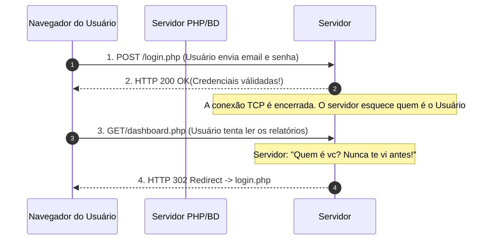
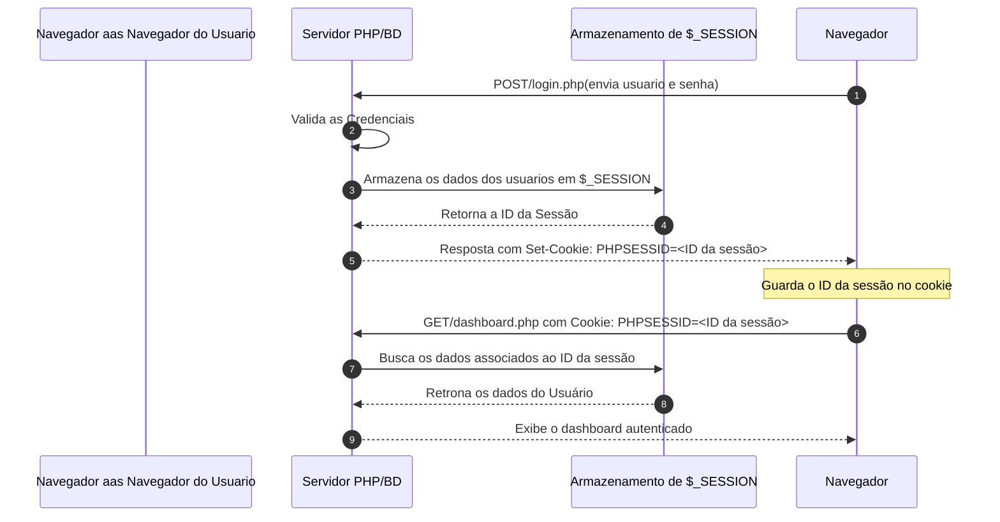
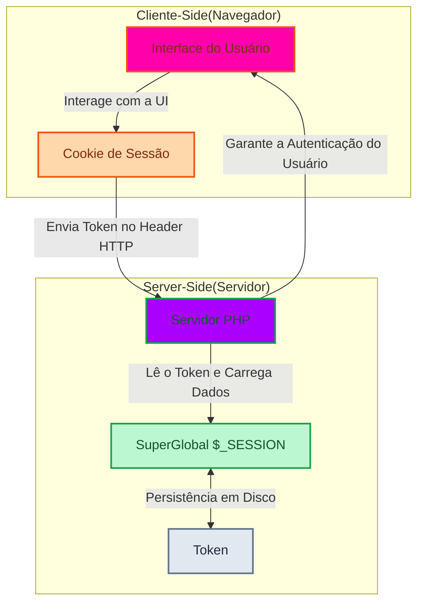
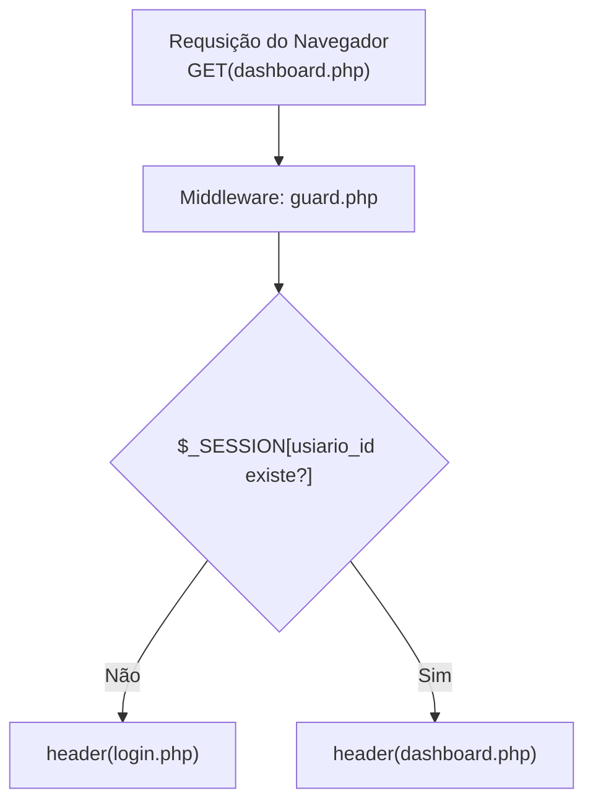

# Sessões, Cookies e Autenticação Segura

**Tema:** Gestão de Estado com  HTTP, Ciclo de Vida da Sessão(`$_SESSION`), Cookies, Hashing de Criptografia, Middleware de Autenticação

## **O Protocolo HTTP: como ele lembra de vc?**

O protocolo HTTP é totalmente **STATELESS (sem armazenamenot de estado)**. Isso significa que o servidor web trata cada requisiição HTTP de forma isolada, como se fosse a primeira vez que ele estivesse interagindo com o usuario do sistema.

**Situação sem armazenamento de Cookie e SESSION**



## Para resolver esse problema sem obrigar o Usuário a digitar o login e a senha dnv a cada clique fazemos o seguinte:

1. Ao fazer o login bem-sucedido, o servidor entrega ao cliente uma **comanda/pulseira VIP numerada** (um identificador de sessão unica e aleatoria)

2. O navegador armazena essa comanda/pulseira em um **cookie**
3. A cada nova pagina solicitada, o navegador apresenta automaticamente essa pulseira no cabeçalho da requisição
4. O PHP lê o numero da comanda/pulseira, localiza os dados do usuario armazenado na memoria do servidor (`$_SESSION`) e reconhece quem é ele!

**Situação com armazenamento de cookie e SESSION**



## **Como funciona o Cookie HTTP**

Um **Cookie** é um pequeno arquivo de texto(geralmente limitado a 4KB) gravado pelo navegador a pedido do servidor, atraves do cabeçalho de resposta `Set-Cookie`

**Cookies podem vazar Informações**

Sim, se um cookie de sessão for configurado com parâmetros desprotegidos, qualquer script malicioso injetado na página(XSS) pode roubar a sessão do usuário logado.

**Para evitar problemas de Segurança em Cookie: usando Flags de segurança**

| Flag de Segurança | O que ela faz? | Por que é indispensável? |
| :--- | :--- | :--- |
| **`HttpOnly`** | Impede que scripts JavaScript executem leitura no cookie via `document.cookie`. | **Neutraliza o roubo de sessão via XSS!** Mesmo que haja uma falha de injeção de script na tela, o navegador proíbe o JavaScript de ler o identificador de sessão. |
| **`SameSite=Lax`** | Restringe o envio do cookie apenas a navegações originadas do próprio domínio. | **Protege contra ataques CSRF** (*Cross-Site Request Forgery*), impedindo que links externos forjem ações logadas. |
| **`Secure`** | Garante que o cookie só seja transmitido em conexões criptografadas com **HTTPS**. | Impede que bisbilhoteiros em redes Wi-Fi públicas interceptem a sessão em trânsito (*Man-in-the-Middle*). *(Em ambiente local de desenvolvimento sem SSL, pode ser desativado temporariamente).* |

## **O ciclo de vida da SESSÃO em PHP: `$_SESSION` no servidor**

Enquanto os cookies residem no navegador, os dados da sessão ficam armazenados com **privacidade total dentro do servidor** (em um arquivo temporario na memoria)




**Sintaxe Essencial do PHP para Sessão**

```php
//configurar as sessão com funções nativas do PHP(Ler documentação)

//1.Configurar as flags dos cookies antes de abrir a sessão
session_set_cookie_params([
    "lifetime"      =>0,        //Cookie expira ao fechar o navegador
    "path"          => "/"      //Valido para todas as paginas do dominio
    "httponly"      =>true      //Proteção contra XSS
    "samesite"      => "Lax"    //proteção contra CSRF
]);

// 2. Iniciar ou restaurar a session ativa
session_start();

// 3. Gravar os dados da sessão (apos validar o login)
//usar superglobais($_SESSION) para isso
$_SESSION["usuario_id"] = 10;
$_SESSION["usuario_perfil"] = "ADMIN";

// 4. Permitir a leitura dos dados em qualquer pagina do meu site
$idLogado = $_SESSION["usuario_id"] ?? null; //se o usuario não tiver feito login a session é null
```

## **Criptografia de senhas**

no passado, desenvolvedores armazenavam senhas utilizando funções matematicas com integridade como `md5($senha)` ou `sha1($senha)`.

> O MD5 foi quebrado em 2004 e o SHA1 foi quebrado em 2017.

**A solução Moderna é Criptografia com uso de Hash**

O padrão de criptografia utilziado são o `Argon2id`, ou o `Bcrypt`

**Caracteristicas da Criptografia de Hash**
1. **Unidirecional(One-way):** É matematicamente impossivel descriptografar o hash para recuperar a seha original, ja que o hash muda cada milisegundo.
2. **Salt Automatico e Aleatorio**: A cada execução, a função gera um vetor de `salt` unico de 16bytes. Mesmo que 2 pessoas tenham a mesma senha, os hashes gerados serão completamente diferentes!.
3. **Custos Ajustaveis**: é possivel calibrar quanto de memoria algoritmo levara para calcular o hash

**Sintaxe Profissional de Cryptografia Moderna**

```php
$senhaDigitada = *******
//
$hash = password_hash($senhaDigitada, PASSWORD_ARGON2ID);
//saída:  $argon2id$v=19#m65536,t=4,p=1$jkhdsfhl...(comprimento ~96 a 128 chars)
```

**O processo de Descriptografia**

```php
$senhaInformada = $_POST["senha"];
$hashDoBanco    = $usuario["hash"];

//o processo de verificação
if(password_verify($senhaInformada, $hashDoBanco)){
    //senha correta
} else{
    //senha incorreta
}
```

>[AVISO!]
> Nunca tente fazer (password_hash($senha) === $hashDoBanco)
> Como o `password_hash` gera um salt aleatório a cada milisegundo, a comparação por igualdade **sempre será falso**
> A Verifiação deve ser feita **exclusivamente** com a função `password_verify()`

## **Arquitetura de Autenticação: Middleware (guard)**

Para impedir que visitantes não logados acessem paginas privadas ( como dashboard.php ou relatorios.php), criamos interceptadores chamados **Guards (Middlewares de Proteção)**.


**Como usar o guard.php**:

Em todas as páginas restritas do sistema a **primeira linha de código** após o `declare(strict_types=1)` será:

```php
required_once __DIR__ . "/src/guard.php";
```

Se a pessoa não estiver autenticada ou não tiver o perfil de acesso, ela é expulsa antes mesmo que qualuqer byte de HTML seja renderizado.

