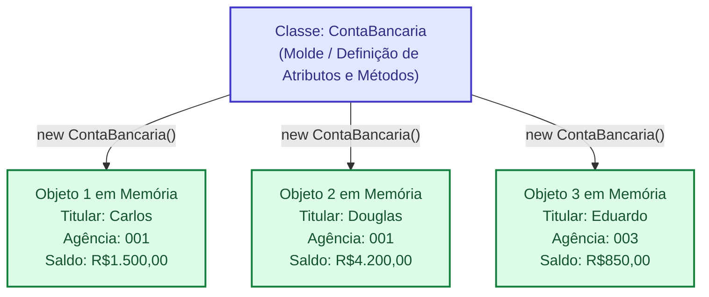
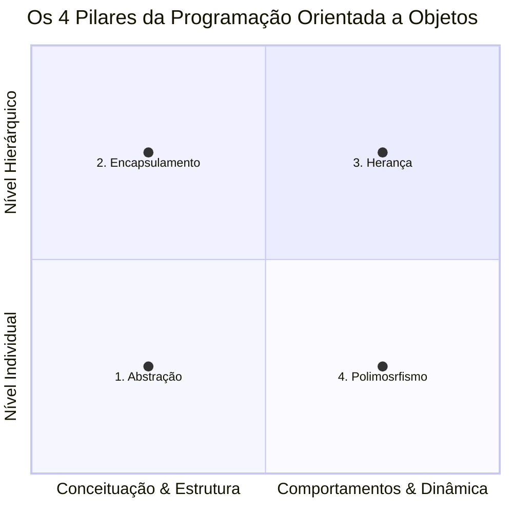
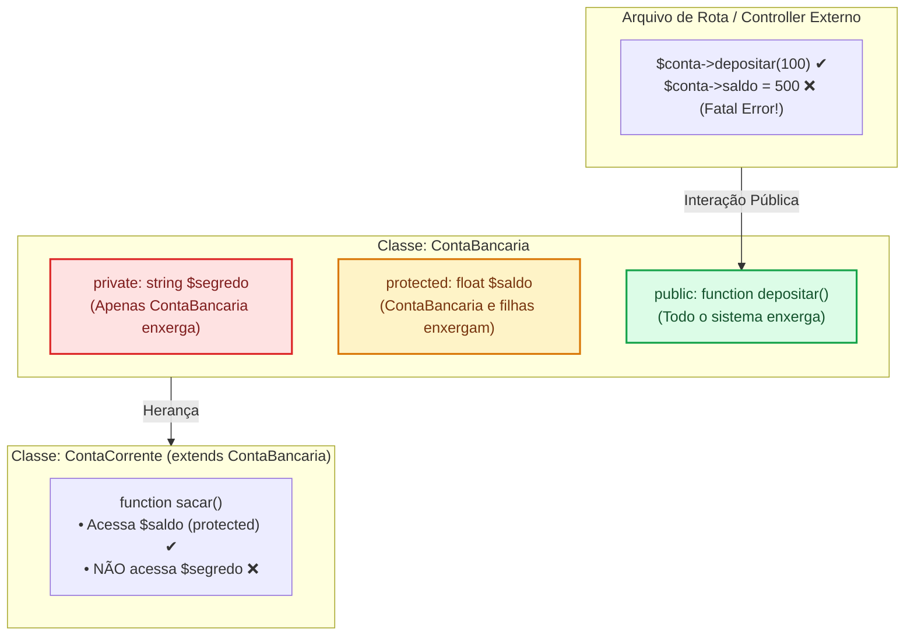
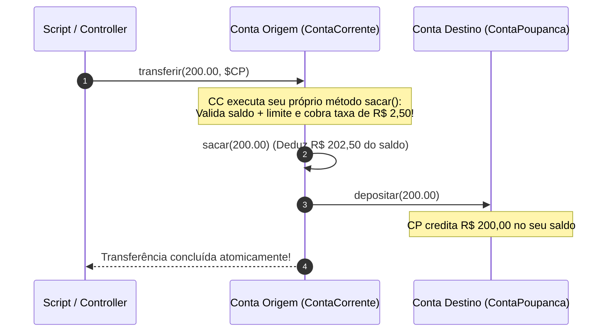
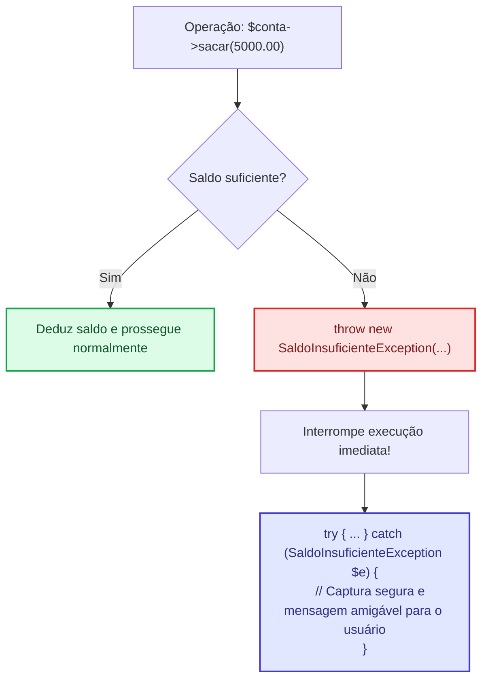

# Programação Orientada A Objetos em PHP
**Tema:** Paradigma de POO, os 4 pilares da Orientação a Objetos (Abstração, Encapsulamento, Herança e Polimorfismo), Classes e instancias, Construtores, Modificadores de acesso (`private`,`protected`e `public`) e modelaem de dados.

#### **Do Procedual a orientação a Objetos**

Na programação procedual manipulação de variaveis, laços de repetição e funções são interpretados de forma linear, ou seja, todo o codigo é escrito em um monobloco (`cidugi de um unico arquivo de programação`), essa abordagem resolve problemas lineares com maestria, mas colapsa rapidamente quando sistemas crescem em escala, complexidade e criticidade de regra de negocio.

Na programação Procedual:
1. **Os dados estao exposto**: qualquer função pode akterar qualquer campo a qaulquer momento.

2. **As regras de validação ficam dispersos**: Cada tela precisa checar uma função, gerando dezenas de `if/else` duplicados espalhados pelo codigo. Se uma regra mudar, o desenvolvedor precisa lembrar de atualziar todos os arquivos do sistema.

3. **Não ha grantia de invariantes**: è impossivel garantir que um dado sempre permaneça em estado consistente.

**O que é Paradigma de Programação Orientado a Objetos (POO)?**

Na **POO**, em vez de separar funções de um lado e dados soltos de outro, nós unimos *dados(atributos)* e as *funções que manipula esses dados(métodos)* dentro de uma única estrutura chamada **Objeto**

**Quadro Comparativo Procedural vs POO:**

| Aspectos | Paradigma Procedural | Praradigma Orientado a Objetos(POO) |
| - | - | - |
| **Unidade Fundamental** | Procedimento e Funções soltas | Classes e Objetos |
| **Proteção de Dados** | Nenhuma (dados globais ou em arrays abertos) | Alta (Encapsulamento) |
| **Reuso de Códigos** | Inclusão de Script (`required_once`) e cópia | Herança(`extends`), Composição e Interfaces |
| **Tratamento de Variaçoes** | Blocos gigantes de `switch` e `if/else` | Polimorfismo e Classes Abstratas |
| **Manutenibilidade**  

### **Anatomia da classe e Objeto**

- **Classe**: é o molde, a planta baixa, o projeto de engenharia. Ela descreve quais atributos(dados) e comportamentos (metodos) as entidades daquele tipo possuirão. Ela reside no codigo-fonte e não ocupa espaço dinamico de dados na memoria. 

- **Objeto**: éo o produto final construido apartir do molde, uma instancia real, palpavel e viva alocada na memoria do servidor durante o cliclo de execução. 



**O Ciclo de Instanciamento de Objetos**

Ao instanciar um objeto com a instrução `new`, o PHP invoca o método constructor especial `__construct()`. E usamos a palavra-chave `$this`para fazer referência direta e exclusiva ao **atributo** que está sendo executado pelo código naquele momento.

```php

class ContaBancaria {
    // Declaração tradicional de atributos tipados
    private string $titular;
    private int $agencia;
    private float $saldo;

    // Método Construtor
    public function __construct(string $titular, int $agencia, float $saldo){
        $this->titular = titular; //this->titualr refere-se ao atributo da classe
        $this->agencia = agencia; //this->titualr refere-se ao atributo da classe
        $this->saldo = saldo; //this->titualr refere-se ao atributo da classe
    }

    // Método de Acesso
    public function getSaldo(): float{
        return $this->saldo;
    }
} //fecha a classe

//Instanciando dois objetos completamentes independentes
$conta1 = new ContaBancaria("Carlos", 001, 100.00);
$conta2 = new ContaBancaria("Douglas", 002, 500.00);

echo $conta1->getSaldo(); // Exibir 100.00
echo $conta2->getSaldo(); // Exibir 500.00
```

>[!OBD:]
>**Alocação de Objetos na Memória**

> No PHP, variáveis que armazenam objetos, usam um **identifiador/referencia** para o endereço na memoria. quando vc passa um objeto par auma função ou metodo, esta passando a refencia na memoria sobre aquele objeto, oque torna o POO extremamente perfomatico.

### **Os 4 Pilares da Orientação a Objetos**



1. **Pilar 1: Abistração**
**definição**: Capacidade de filtrar detalhes irrelevantes e focar estritamente nas caracteristicas e comportamentos essenciais da entidade para o contexto do software, que esta sendo construido.
*Exemplo*: Para um sistema bancario o que importa em um cliente é seu nome, CPF e renda. Sua altura ou cor favorita, são abstrações e podem ser descartados.

2. **Pilar 2: Encapsulamento**
**Definição**: Blindagem dos estados internos do objeto. Os atributos devem ser protegidos conta acessos ou modificações diretas pelo mundo exterior. Akterações no estado só ocorrem atraves de metodos públicos que validam regras de negocio e mantem invarantes contaveis.

3. **Pilar 3: Herança**
**Definição**: Mecanismo pelo qual  uma clasee filha ( subclasee) herda atributos e comportamentos de uma classe ancestral (superclasse), promovendo o reuso de codigo e estabelecendo uma relação do tipo `É UM`
*Exemplo*: Um cachorro(subclasse) é um Mamifero(superclasse)=> porque ele herda caracteristiacs da classe dos mamiferos

4. **Pilar 4: Polimorfismo**
**Definição**: Princípio que permite que classe filhas diferentes respondam a mesma chamada de método, porém, com mimplementações especializads e comportamentos distintos. O chamador não precisa saber qual subclasse exata esta executando, apenas confia que o metodo cumpra o contrato.

### **Encapsulamento**

Os Modificadores de visibilidade:

| Modificador | Onde pode ser acessado? | Recomendação de Uso |
| :--- | :--- | :--- |
| **`private`** | **Apenas** dentro da própria classe que o declarou. Subclasses e scripts externos não conseguem ler nem alterar. | **Padrão ouro para atributos.** Garante proteção absoluta de estado e impede efeitos colaterais. |
| **`protected`** | Dentro da própria classe e por quaisquer **subclasses que a herdem (`extends`)**. O mundo exterior continua bloqueado. | Usado quando subclasses precisam ler ou ajustar diretamente um valor compartilhado (ex.: `$saldo` em classes filhas de conta). |
| **`public`** | Acessível livremente por **qualquer parte do sistema**, dentro ou fora da classe. | Usado para os métodos que compõem a **interface pública** do objeto (ações como `sacar()`, `depositar()`, `transferir()`). |

Grafico Representativo dos modificadores de acesso em Heranças



**Usando Getter and Setters**

Ao declar atributos privados ou protegidos (`private` ou `protected`), se vc deseja manipular esses atributos é importante criar os **modificadores de acesso** atraves dos `getters and setters`

*Exemplo:* Ao criar um atributo `private float $saldo`, para modificar os valores ou ler o saldo é importante criar os metodos publicos

- `public function getSaldo()`: Permite consultar o valor do saldo
- `public function setSaldo()` : permite alterar o valor do saldo

>[!Cuidado]
> **Não destrua seu encapsulamento**: para atributos que não serão modificados, como CPF, por exemplo, não há necessidade de criar um `setCPF()`, o CPF de uma pessoa não sera modificado ao longo da vida.

## **Herança, Classes Abstratas e Polimorfismo**

**Classe Abstrata**: Uma Classe Abastrata é uma superclasse conceitual que **não pde ser instanciada diretamente com `new`**. Ela serve como matriz para que subclasses concretas sejam derivadas.

```php
abstract class ContaBancaria {
    //superclasse -> passa informações para as subclasses (herança)
    protected float $saldo;
    //construtor
    public function __construct(float $saldoInicial){
        $this->saldo = $saldoInicial;
    }
    //metodos de acesso (getters and setters)
    public function getSaldo(): float {
        return $this->saldo;
    }
     //método abstrato: Obriga a subclasse a criarem, porem não vai fornecer a implemetação do método(polimorfismo)
    abstract public function sacar(float $valor):void; 

}

//Se um objeto da classe ContaBancaria tentar ser instanciado, vai gerar um erro na compilação
$conta =  new ContaBancaria(100); //Error:Cannot instantiate abstract class ContaBancaria
//Não pode instanciar OBJ da Classe Abstrata
```

**Herança**: Usar o mecanismo de criação de subclasses apartir da superclasse (extends)

```php
class ContaCOrrente extends ContaBancaria {
    //não precisa redeclarar os atributos e métodos já criados na superclasse
    //a unica coisa que preciso implementar é o método sacar
    public function sacar(float $valor): void {
        //implementar a logica de negocio para contacorrente
        $this->saldo -= $valor + 2.50; //taxa de saque de 2.50
    } 
}

class ContaPoupanca extends ContaBancaria {
    //outro metodo para sacar
    public function sacar(float $valor): void {
        //implementar a logica de negocio para ContaPoupanca
        if($valor <= $this->saldo){
            $this->saldo -= $valor;//n tem taxa
        }else{
            echo "Pode sacar n o burrao, valor maior do que tu tem";
        }
    }
}

$contaCorrente = new ContaCorrente(1000.00);
$contaPoupanca = new ContaPoupanca(500.00);

$contaCorrente->sacar(100.00); //Deduz R$ 102,50
$contaPoupanca->sacar(100.00); //Deduz R$ 100.00


$contaCorrente->getSaldo(); //retorna 897,50
$contaPoupanca->getSaldo(); //retorna 400,00
```

>Obs: Ambas as classes implementam o metodo `sacar()` de maneira diferentes, respeitando as regas de negocio específicas de cada tipo de conta.

**Polimorfismo:** O método`sacar()`na classe ContaBancaria demonstra o polimorfismo em ação.



### **Técnicas e Tratamento de Exceções**

**Constructor Property Promotion (Declaração no Construtor)**

No PHP 8.X Podemos utilizar recursos modernos que reduzem o código repetitivo e elevam a segurança. O uso do `Property Promotion`no construtor é um exemplo, não precisamos declarar os atributos e depois fazer o construtor, basta declarar os atributos diretamente dentro do construtor.

```php
class TitularProperty {
    public function __construct(
        private string $nome,
        private string $cpf
    ){}
}

//isso é igual 

class TitularSemProperty {
    private string $nome;
    private string $cpf;

    public function __construct(string $nome, string $cpf){
        $this->nome = $nome;
        $this->cpf = $cpf;
    }
}

```

**Exceções de Domínio: Tratamento de Erros do Sistema**

Um dos maiores erros cometidos em sistemas procedurais é o retorno mágico de valores como `-1`, `false` ou `null` quando uma regra de negócio é violada.

**Para Corrigir esses Erros Mágicos** devemos usar `throw Exception`

Se o método retornar `false` quando ocorrer um erros, o desenvolvedor não fez o tratamento de erros corretamente. Exemplo: Se o `sacar()` retornar `false`quando não houver saldo, o sistema continuará executando como se o dinheiro tivesse saído causando furos de caixa no sistema. Já quando usamos uma **Exceção de Domínio**, a execução é interrompida e feito um tratamento usando um bloco `try/catch`.




>[!OBS]
>`try/catch` é o mecanismo de captura de exceções do PHP. Ele permite que você trate erros de forma inteligente, mantendo a integridade do sistema e fornecendo feedback claro ao usuário.

