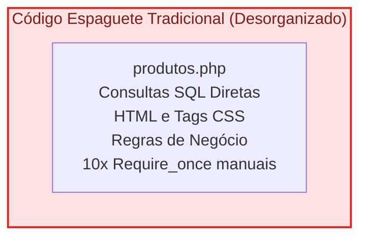
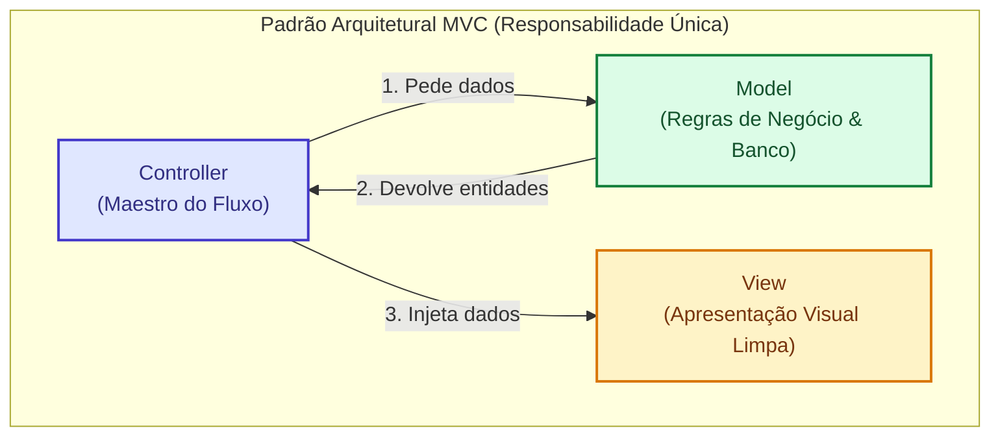
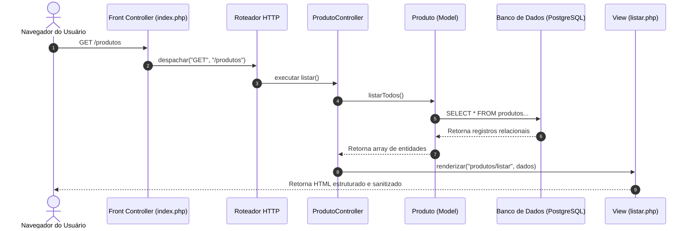
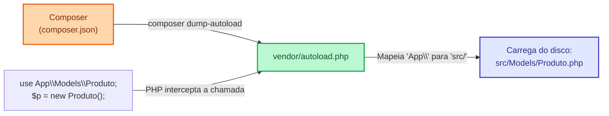
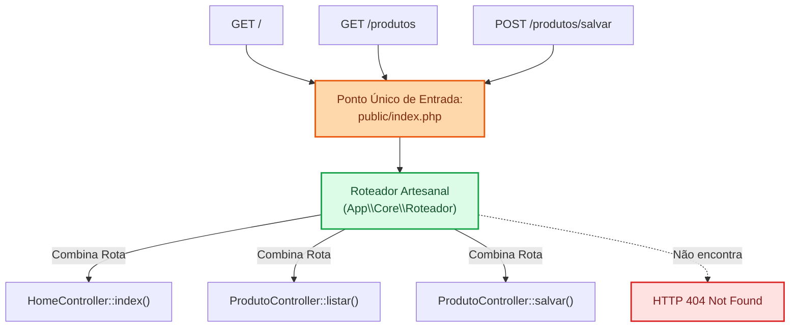

# Arquitetura MVC Artesanal

**Tema:** Pradrão Arquitetural MVC(Model-View-Controller) em BackEnd. Gestão de Dependências Composer, Especificações de Autoloading PSR-4, Resolução Automática de NamesSpace, Padrão DrontController, Roteador HTTP Artesanal e Injeção de Dados em Views.

#### **O fim do Código Espaguete**

Quando encontramos um padrão de código desastroso e caótico, sem arquiteturas modernas de Desenvolvimento, usamos o termo `Código Espaguete`.

Exemplo de Código Espaguete:

```php
<!-- ARQUIVO LEGADO: produtos.php (O PESADELO DO CÓDIGO ESPAGUETE) -->
<?php
// 1. Múltiplos includes manuais frágeis
require_once __DIR__ . '/../config/conexao.php';
require_once __DIR__ . '/../classes/Produto.php';
require_once __DIR__ . '/../classes/Sessao.php';
require_once __DIR__ . '/../classes/Auditoria.php';

// 2. Mistura de lógica de banco e processamento HTTP
$pdo = Conexao::getInstancia();
if ($_SERVER['REQUEST_METHOD'] === 'POST') {
    $nome = $_POST['nome'];
    $stmt = $pdo->prepare("INSERT INTO produtos (nome) VALUES (?)");
    $stmt->execute([$nome]);
}
$produtos = $pdo->query("SELECT * FROM produtos")->fetchAll();
?>
<!-- 3. HTML misturado com PHP procedural na mesma folha -->
<html>
<body>
    <h1>Catálogo</h1>
    <?php foreach($produtos as $p): ?>
        <p><?= $p['nome'] ?></p>
    <?php endforeach; ?>
</body>
</html>
```

**Os Problemas Críticos do Código Espaguete**

1. _Acoplamento Máximo_: Se você mudar o layout visual, corre o risco de quebrar uma query SQL. Se alterar uma coluna do banco, precisa reescrever o arquivo vicual.
2. _Fragicilidade de Inclusões (`required_once`):_ Se um arquivo for movido de pasta, todas as chamadas `required_once`quebram com erros fatais de arquivos não encontrados.
3. _Exposição de Segurança_: Se os arquivos PHP estiverem na raiz acessível do servidor web, qualquer usuário malicioso pode tentar acessar scripts internos digitando `http://site.com/config/conexao.php`.



### A Triade Model-View-Controller (MVC) no BackEnd

O Padrão `MVC (Model-View-Controller)` é a arquitetura de software corporativa mais consagrada da historia da web. Seu objetivo é separar as preucupações do sistema em **3 camadas bem definidas**:





1. **Model (Camada de Modelo de Negócio e Dados)**

- **O que Faz**: Representa as entidade do mundo real e gerencia a lógica de dados, persistência e regras de negócio
- **O que sabe**: Sabe como conectar ao banco de dados, executar Prepared Statement, validar se um preço é positivo (RN) e calcular totais de estoque (RN)
- **O que NUNCA faz**: Nunca emite comando `echo`, nunca gera tag HTML e nunca lê dados da superglobal `$_POST` ou `$_GET`.

2. **View (Camada de Visualização e Apresentação)**
- **O que Faz**: Renderiza a interface gráfica do usuário(geralmente HTML, CSS, JSON).
- **O que sabe**: Recebe variáveis simples enviadas pelo Controller e as formata visualmente, aplicando sanitizção ativa contra XSS(`htmlspecialchars)
- **O que NUNCA faz**: Nunca executa consultas sql, nunca faz regras de negocio complexas e nunca redireciona requisições via `header()`

1. **Controller (Camada de Controle e Orquestração)**
- **O que Faz**: Atua como o maestro da aplicação. Recebe a requisição do usuario, valida as estradas aciona a camada Model para obter ou persistir informações e seleciona a View correspondente para renderizar a resposta
- **O que sabe**: Sabe qual Model chamar e qual View devolver.
- **O que NUNCA faz**: Não deve conter regras contabeis complexas (elas pertencem ao Model) e não deve escrever HTML diretamente.

### **O gerenciador Composer e o AutoLoad PSR-4**

Imagina um projeto corporatvo com ais de 300 classes e ter que escrever 300 linhas de `required_one` em cada arquivo tornaria o desenvolvimento inviavel. É aqui que o **Composer** e a especificação **PSR-4**


**Oque é o Composer?**

O **Composer** é o gerenciador de dependências oficial da linguagem PHP. Ele desempenha duas funções vitais:
1. Baixar bibliotecas de terceiros a partir do repositório central Packagist (como bibliotecas de envio de e-mails, geradores de PDF e frameworks).
2. **Gerar o Autoloader Automático:** O Composer lê as classes criadas por você no seu projeto e as disponibiliza automaticamente no codigo sem a necessidade de nenhum `require`.

**As especificações do PSR-4 (PHP Stadart Recommendation)**:

A especificação internacional **PSR-4** dita que:
> *O namespace de uma classe deve espelhar exatamente a estrutura de diretórios no disco físico onde o arquivo está gravado.*

Exemplo prático:
- Se declaramos o namespace: `namespace App\Controllers; class ProdutoController {}`
- E configuramos no Composer que o prefixo `"App\\"` aponta para a pasta `"src/"`.
- O PHP localizará fisicamente o arquivo em: `src/Controllers/ProdutoController.php`.

**Como Configurar o composer.json**

```json
{
    "name": "senai/supply-mvc",
    "description": "Sistema de Gestão de Insumos Industriais",
    "type": "project",
    "autoload": {
        "psr-4": {
            "App\\": "src/"
        }
    }
}
```

> [!IMPORTANT]
> **Comando Mandatório de Regeneração:**  
> Sempre que você criar o arquivo `composer.json` ou alterar a estrutura de namespaces, execute no terminal do VS Code:  
> `composer dump-autoload -o`  
> O parâmetro `-o` gera o mapa de classes otimizado para máxima performance.


#### **O Padrão Front Controller e Roteamento HTTP**

Em aplicações PHP procedurais antigas, a URL do navegador correspondia exatamente a um arquivo gravado no disco:
- `http://site.com/contato.php` ➔ Carrega o arquivo `contato.php`.
- `http://site.com/admin/relatorio.php` ➔ Carrega o arquivo `admin/relatorio.php`.

Em arquiteturas corporativas modernas (incluindo **Laravel**, **Symfony** e **Spring Boot**), essa correspondência direta não existe mais. Em vez disso, utilizamos o **Padrão Front Controller**.



**Por que isolar o diretorio `public/`?**

Por razões estritas de **Segurança da Informação**:
1. O servidor web aponta sua raiz estritamente para a pasta `public/`.
2. As pastas `src/`, `config/`, `vendor/` e os arquivos `.ini` e `.env` ficam **um nível acima da raiz pública**.
3. Mesmo que um atacante tente digitar diretamente a URL de um arquivo sensível (ex.: `http://site.com/config/database.ini`), o servidor web bloqueia o acesso, pois o arquivo não reside na pasta pública.