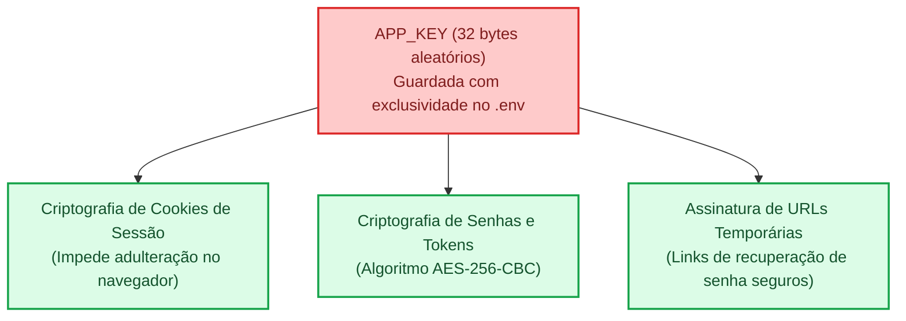
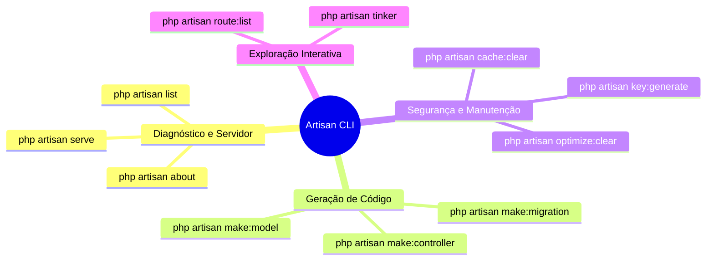

### Semana 13 - Introdução ao Framework Laravel e Artisan CLI

**Tema:** Módulo 3 - Framework Laravel, Evolução da Arquitetura MVC Artesanal para MVC do Ecossistema Laravel, Estrutura Enxuta, Mapeamento de Diretórios. Gestão Segura de Ambientes com `.env`, Chaves Criptografadas de aplicação, Ferramenta de Linha de Comando `Artisan CLI`, Ciclo de Vida de Requisição do Framework. 


#### **O que é o Framework Laravel?**

Criado em 2011 por Taylor Otwell, o **Laravel** é atualmente o framework mais popular e consolidade do ecossistema PHP. Ele é um **framework MVC Completo**, que oferece uma estrutura de desenvolvimento robusta, segura e escalável para aplicações web modernas e corporativas. Ele Adota o Princípio de **Convenção sobre Configuração** e Entrega uma série de recursos prontos para uso, incluindo:

1. **Produtividade Imediata**: Estrutura padronizada onde todo desenvolvimento segue convenções claras, reduzindo a necessidade de configuração manual.
2. **Segurança por Padrão(Security by Default)**: Proteção nativa e automática contra XSS, CSRF, SQL Injetion, manipulação indevida de cookies e ataques de força brute.
3. **ORM Eloquent**: Uma ferramenta de mapeamento objeto-relacional (ORM) que simplifica a interação com banco de dados, permitindo consultas e manipulações de dados usando sintaxe PHP fluente.
4. **Ferramenta de Linha de Comando (Artisan CLI)**: Automatiza a criação de classes, execução de migrações de banco, limpeza de cache e outras tarefas repetidas, aumento de produtividade no desenvolvimento.
5. **Comunidade Global e Ecossistema Rico**: Milhares de pacotes prontos para autenticação robusta, mensageria, fila assincronas, geração de APIs restful, testes automatizados e muito mais. 

Ao longo das últimas semanas, estudamos a estrutura de projetos em PHP puro. E agora, vamos migrar para o **Laravel**, abaixo uma tabela comparativa entre o MVC artesanal e o Laravel:

Componente Arquitetural | No Seu MVC Artesanal (Semana 12) | No Framework Laravel (Semana 13+) | Vantagem Competitiva no Mercado |
| :--- | :--- | :--- | :--- |
| **Ponto Único de Entrada** | `public/index.php` | `public/index.php` | Mesma raiz segura: isola todo o código-fonte da web pública. |
| **Autoload de Classes** | `composer.json` (PSR-4: `"App\\": "src/"`) | `composer.json` (PSR-4: `"App\\": "app/"`) | Padrão unificado internacional da PHP-FIG. |
| **Mecanismo de Roteamento** | `App\Core\Roteador` com array interno | `routes/web.php` e `routes/console.php` | Roteamento declarativo com middlewares, parâmetros dinâmicos e grupos de rotas. |
| **Camada de Controle** | `App\Controllers\ProdutoController` | `App\Http\Controllers\AtivoController` | Integração automática com Injeção de Dependências e validação de Form Requests. |
| **Camada de Dados (Model)** | `App\Models\Produto` com PDO manual | `App\Models\Ativo` (*Eloquent ORM*) | Mapeamento Objeto-Relacional avançado com relacionamentos expressivos (`hasMany`, `belongsTo`). |
| **Camada de Visualização** | Scripts PHP nativos com `extract()` | Motor de Templates **Blade** (`.blade.php`) | Sintaxe limpa, herança de layouts, componentes reutilizáveis e escape automático contra XSS. |
| **Isolamento de Credenciais** | `config/database.ini` | Arquivo `.env` (Padrão 12-Factor App) | Paridade entre ambientes (local, homologação e nuvem) com segurança estrita. |

>[!Observação]
>Construir o MVC Artesanal na semana 12 foi como desmontar e criar a mão cada engrenagem, pistão e freio de um motor automotivo. Agora que você compreendeu como montar funciona, não precisa mais reinventar a roda em cada nova fase, você já assume a cabine do piloto de Fórmula 1 de última geração. 

#### **Rotas Enxutas e Parametrizadas com Laravel 11**

No **Lavarel 11**, lançado com foco em performance, e simplicidade, a arquitetura foi completamente desidratada e enxuta. Permitindo que o desenvolvedor foque mais na lógica de negócio e menos em configurações complexas. Abaixo, um exemplo de rotas simples e parametrizadas:

```php
use App\Http\Controllers\AtivoController;

Route::get('/', [AtivoController::class, 'index'])->name('ativos.index');
Route::get('/ativos/create', [AtivoController::class, 'create'])->name('ativos.create');
Route::post('/ativos', [AtivoController::class, 'store'])->name('ativos.store');
Route::get('/ativos/{ativo}/edit', [AtivoController::class, 'edit   '])->name('ativos.edit');
Route::put('/ativos/{ativo}', [AtivoController::class, 'update'])->name('ativos.update');
Route::delete('/ativos/{ativo}', [AtivoController::class, 'destroy'])->name ('ativos.destroy');
``` 

As 3 Grandes Mudanças Estruturais do Laravel 11:
1. **O Novo Núcleo `bootstrap/app.php`:** Toda a configuração de rotas (`web`, `commands`), middlewares globais e tratamento centralizado de exceções agora é feita de forma fluida (*fluent API*) em um único arquivo.
2. **Rotas Minimalistas por Padrão:** O arquivo `routes/web.php` já vem pronto para rotas de interface web. As rotas de API (`routes/api.php`) só são criadas quando o desenvolvedor decide ativá-las através do comando `php artisan install:api`.
3. **Menos Boilerplate em Controllers e Models:** Classes base limpas, sem heranças desnecessárias de dezenas de traits que não estavam sendo utilizados.


#### **3. O Mapeamento de Diretórios do Laravel**

Ao criar uma nova aplicação Laravel, a estrutura de diretórios é organizada de forma a separar claramente as responsabilidades do sistema. Usando o Princípio de Responsabbilidade Única**.

```text
senai-asset-manager/
├── app/                  <- O coração da sua lógica de negócios
│   ├── Http/
│   │   └── Controllers/  <- Seus Controllers residem aqui
│   ├── Models/           <- Seus Modelos Eloquent residem aqui
│   └── Providers/        <- Provedores de serviços da aplicação
├── bootstrap/            <- Inicialização do framework
│   ├── app.php           <- Ponto central de configuração de rotas e middlewares
│   └── cache/            <- Caches de inicialização do sistema
├── config/               <- Arquivos de configuração publicáveis (banco, sessão, etc.)
├── database/             <- Engenharia de Banco de Dados
│   ├── factories/        <- Fábricas de dados falsos para testes (Faker)
│   ├── migrations/       <- Controle de versão do esquema do banco de dados
│   └── seeders/          <- Scripts para popular tabelas com dados iniciais
├── public/               <- A ÚNICA PASTA ACESSÍVEL PELO SERVIDOR WEB
│   ├── css/              <- Folhas de estilo compiladas
│   ├── js/               <- Scripts front-end
│   ├── index.php         <- O Front Controller da aplicação
│   └── robots.txt
├── resources/            <- Recursos brutos da interface com o usuário
│   ├── css/              <- Arquivos CSS pré-compilação (Tailwind)
│   ├── js/               <- Arquivos JavaScript pré-compilação
│   └── views/            <- Templates do motor de visualização Blade (.blade.php)
├── routes/               <- Mapeamento de rotas do sistema
│   ├── console.php       <- Comandos de terminal customizados baseados em Closure
│   └── web.php           <- Rotas HTTP para navegadores (com cookies e sessões)
├── storage/              <- Arquivos gerados em tempo de execução
│   ├── app/              <- Uploads e arquivos gerados pelo sistema
│   ├── framework/        <- Sessões de arquivo, views compiladas e caches
│   └── logs/             <- Logs cronológicos de erro e auditoria (laravel.log)
├── tests/                <- Testes automatizados unitários e de integração
├── .env                  <- ARQUIVO CONFIDENCIAL de variáveis de ambiente
├── .env.example          <- Modelo público de variáveis para a equipe
├── .gitignore            <- Impede o vazamento de segredos para o Git
├── artisan               <- O executável da CLI Artisan
└── composer.json         <- Manifesto de dependências e autoload PSR-4
```

> [!Cuidado]
> Apenas a pasta `public/` deve ser apontada pelo servidor web.
> Nunca aponte o servidor web para a raiz do projeto! Se fizer isso, qualquer visitante poderá navegar até `http://seusite.com/.env/` e baixar todas as senahs do banco de dados e chaves de API da empresa.

> [!Observação]
> `.env` ou `database.ini`: são arquivos para armazenamento de informações/dados sensíveis da aplicação.
> `.gitignore`: nesse arquivo são colocados os nomes dos arquivos e pastas que não devem ser versionados (não são exposoto no git e github).


#### **Segurança no Ambiente de Desenvolvimento e Produção**

Em Sistemas corporativos, uma aplicação passa por múltiplos ambientes ao longo do seu ciclo de desenvolvimento.

- **Ambiente local**: Na máquina de trabalho do desenvolvedor, com exibição detalhada de erros e banco de dados local.
- **Ambiente de Homologação**: Servidor de testes, onde a equipe de QA valida funcionalidades antes do lançamento.
- **Ambiente de Produção**: Servidor público, onde a aplicação é acessada pelos usuários finais. Aqui, erros detalhados não devem ser exibidos para o público. `APP_DEBUG` deve ser `false` para não expor informações sensíveis.


1. **O Padrão de Segurança `12-Factor`e o Arquivo `.env`**

Em vez de alterar senhas dentro do código PHP a cada deploy, o Laravel utiliza o padrão internacional de isolar as variáveis que mudam de ambiente em um arquivo de texto simples chamado `.env` (Environments Variables).

2. **A Chave de Segurança `APP_KEY`**.

A `APP_KEY` é a sequencia criptografada aleatória de 32 bytes codificada em Base64 gerada automaticamente pelo Laravel, como padrão de segurança em qualquer aplicação.

>[!Observação]
> Se a `APP_KEY` estiver vazia, o Laravel recusará a execução exibindo um erro na tela *No Application encryption key has been specified*
> Se ocorrer a troca da `APP_KEY` em um sistema em produção, todas as sessões ativas cairão e os dados cifrados  com a chave antiga se tornarão inválidos e irrecuperáveis.

3. **O papel do `.env.example`**

Como o arquivo `.env` esta listado no `.gitignore` e nunca vai para o Github, como um colega de equipe sabe quais variaveis ele precisa configurar ao clonar o repositorio?Atraves do `.env.example`, ele serve como um template documentado contendo as memas chaves do `.env`, porem com valores ficticios ou vazios.



#### **5. Artisan CLI: O poder da linha de comando**

O **Artian CLI** é a interface de linha de comando  (Command-Line-Interface) nativa do Laravel. ele é executado a partir do arquivo executavel `artian` localizado na raiz do projeto.

```bash
php artisan [comando] [argumentos] [opções]
```

**Principais comandos do Artisan CLI para a rotina de desenvolvimento**

1. `php artisan serve`
Inicializa o servidor HTTP local embutido de desenvolvimento, escutando por padrão em `http://127.0.0.1:8000`. É muito superior ao `php -S localhost:8000 -t public` tradicional porque já configura automaticamente o roteamento de assets estáticos e tratamento de reescrita de URL.
- Para mudar a porta: `php artisan serve --port=8080`

2. `php artisan key:generate`
Gera uma chave criptográfica segura de 256 bits através de gerador de números pseudoaleatórios criptograficamente seguros e grava diretamente na variável `APP_KEY` do seu arquivo `.env`.

3. `php artisan about`
Introduzido nas versões modernas do Laravel, este comando faz uma varredura completa da saúde do ecossistema e imprime uma tabela no terminal com:
- Versão do PHP e extensões carregadas.
- Versão do Laravel instalada.
- Status do ambiente (`local`, `production`).
- Status do modo de depuração (`Debug Mode: ENABLED/DISABLED`).
- Drivers ativos de Banco de Dados, Cache, Sessão e Filas.

4. `php artisan list`
Exibe o catálogo completo de comandos disponíveis na aplicação, agrupados por categorias (`make:`, `migrate:`, `route:`, `db:`, `config:`).

5. `php artisan make:controller NomeDoController`
Gera automaticamente um novo arquivo de classe Controller já configurado com o namespace correto (`App\Http\Controllers`), herança da classe base e declarações estritas, eliminando erros manuais de digitação.

6. `php artisan make:model NomeDoModel`
Gera automaticamente a classe de modelo Eloquent sob a pasta `App\Models`.

7. `php artisan route:list`
Gera uma tabela formatada no terminal listando todas as rotas registradas na aplicação, incluindo os verbos HTTP correspondentes (GET, POST), URIs, nomes de rota e a respectiva ação no Controller.

8. `php artisan tinker`
Abre um terminal interativo (*REPL - Read-Eval-Print Loop*) baseado no PsySH. Permite testar comandos PHP, instanciar models, consultar bancos de dados e verificar configurações diretamente pela linha de comando com toda a aplicação Laravel inicializada em memória!

9. `php artisan migrate`
Executa todas as migrações pendentes, criando ou alterando tabelas no banco de dados conforme definido nos arquivos de migração sob as pastas `database/migrations/`.

