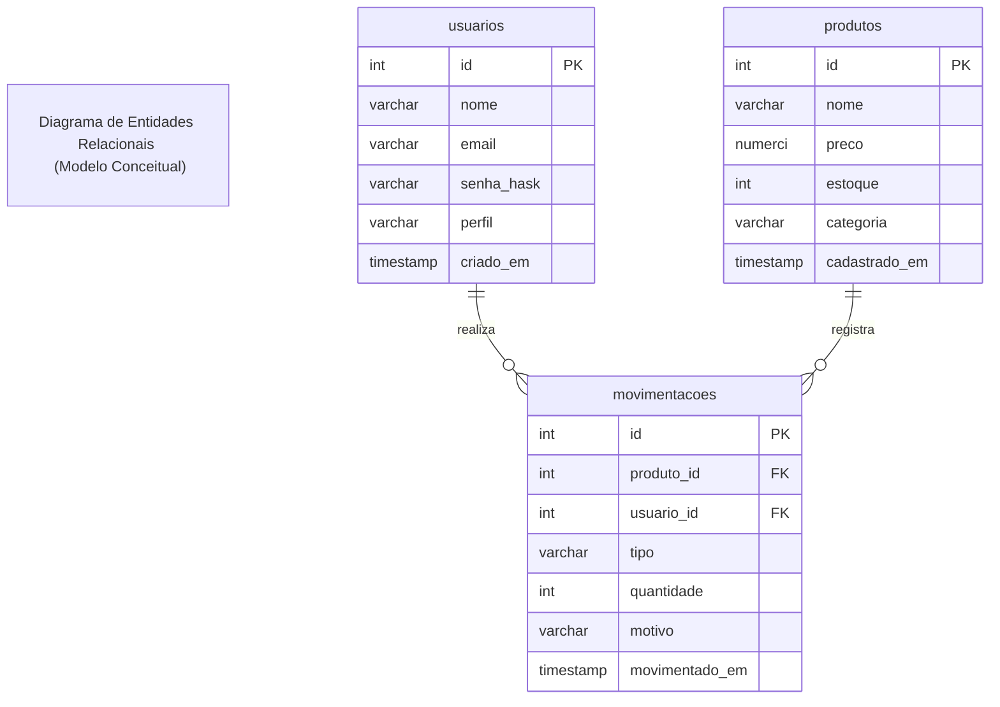

# SENAI Suply MVC - Especificação Inicial de Requisitos

## 1. Identificação

- Projeto: Senai Suply MVC
- Versão 1.0
- Estado: proposta inicial, sujeita a alterações
- Responsável: Equipe de Desenvolvimento I1D46B

## 2. Objetivos

Desenvolver uma aplicação web didátioca para consultar o catálogo de insumos insdustriais e acompanhar a quantidade em estoque, aplicando arquitetura MVC artesanl com PHP, Composer , PDO e PostgreSQL

## 3. Escopo

Este projeto exibira uma painel de estoque, lista de insumos, permitira cadastrar novos itens e apresentar uma tela de login com autenticação de usuário. 

### 3. 1 Partes interessas e usuarios

- Almoxarife: consultar o catalogo e cadastrar insumos
- Gestor: acompanhar as quantidades agregadas no painel
- Equipe de Desenvolvimento: implementar e validas os requisitos do sistema

### 3.2 Ambientes e dependências

- PHP 8.3 ou superior, Composer, extensão PDO para PostgreSQL
- Banco de dados PostgreSQL com o script schema.sql
- Servidor web configurado
- Navegador com suporte a HTML5

## 4. Requisitos do sistema

### 4.1 Requisitos Funcionais (RF)

- **RF-001** - Autenticação de Usuários: O sistema deve autenticar o usuário por e-mail e senha
- **RF-002** - Logout Seguro: O encerramento da sessão deve ocorrer exclusivamento via `POST/logout`
- **RF-003** - Guard de Autenticação: Rotas restritas devem direcionar usuário para login
- **RF-004** - Guard de Autorização por Perfil: retrição de Rotas por Perfil de Usuário
- **RF-005** - Catalogo de Produtos: `GET` listar produtos
- **RF-006** - Cadastrar Produtos: `POST` persistir novo produto
- **RF-007** - Atualizar Registro de Produtos: `UPDATE` de produtos
- **RF-008** - Registro de Movimentação: `POST`movimentação
- **RF-009** - Validação de Movimentações: impedir movimetações indevidas
- **RF-010** - histórico de Movimetações: `GET`listar as movimetações
- **RF-011** - Registro de Logs : aramazenar eventos de logs em logs/app.log


### 4.2 Requisitos Não Funcionais (RNF)

- **RNF-001** - Segurança de Senhas: Usar criptografia para salvar as senhas no banco
- **RNF-002** - Integridade Transacional (ACID): Movimentações devem usar PDO
- **RNF-003** - Prevenção XSS: sanitização de dados com `htmlspecialchars`
- **RNF-004** - Utilização de Arquitetura MVC: utilização de Model-View-Controller Artesanal


## Diagramas do Sistema

### Diagrama das Entidades Relacionais (DER)



## Estrutura Completa de Diretorios do Projeto (Arquitetura MVC)

Crie Rigorosamente a seguinte arvore de pastas e arquivos no seu espaço de trabalho

```text
senai-supply-mvc/
├── README.md                   <- Requisitos e critérios de aceitação
├── composer.json               <- Mapeamento de Autoload PSR-4
├── config/
│   └── database.ini            <- Credenciais isoladas do Banco de Dados
├── logs/
│   └── app.log                 <- Arquivo de logs e auditoria da aplicação
├── public/
│   └── index.php               <- Front Controller (Ponto único de entrada)
├── schema.sql                  <- DDL de usuários, produtos e movimentações
└── src/
    ├── Controllers/
    │   ├── AuthController.php          <- Login, autenticação e logout
    │   ├── HomeController.php          <- Dashboard e métricas de estoque
    │   ├── MovimentacaoController.php  <- Registro e auditoria de movimentações
    │   └── ProdutoController.php       <- Catálogo e cadastro de insumos
    ├── Core/
    │   ├── ConexaoBanco.php    <- Provedor Singleton de conexão PDO
    │   ├── Controller.php      <- Classe base abstrata com renderização e CSRF
    │   ├── Guards/
    │   │   └── AuthGuard.php   <- Middleware/Guard de autenticação e perfis
    │   ├── Logger.php          <- Serviço centralizado de logs da aplicação
    │   └── Roteador.php        <- Roteador HTTP artesanal com suporte a Guards
    ├── Models/
    │   ├── Movimentacao.php    <- Regras e transação de movimentação (ACID)
    │   ├── Produto.php         <- Regras de negócio e catálogo de insumos
    │   └── Usuario.php         <- Persistência e busca segura de usuários
    └── Views/
        ├── layout/
        │   ├── header.php      <- Cabeçalho com sessão, perfil e logout
        │   └── footer.php      <- Rodapé corporativo compartilhado
        ├── auth/
        │   └── login.php       <- Formulário de autenticação com CSRF
        ├── home/
        │   └── index.php       <- Dashboard com métricas gerais
        ├── movimentacoes/
        │   ├── historico.php   <- Tabela de auditoria de movimentações
        │   └── novo.php        <- Formulário para registrar entrada ou saída
        └── produtos/
            ├── criar.php       <- Formulário de novo insumo
            └── listar.php      <- Tabela de insumos com atalho de movimentação

```

## Etapas de Desenvolvimento do Projeto

### Modelagem Relaional e Script DDL (`schema.sql`)

Criar o Banco de dados e executar o Script SQL para Criar as Tabelas

### Configurar O AutoLoad PSR-4 (composer.json)

Criar o arquivo `composer.json` na raiz do projeto

- composer.json => gerenciador de dependencia do projeto

- PSR-4 => biblioteca de mapeamento de arquivos do projeto evita a neessidade de usar `required_once`

> Obs: antes de rodar o projeto: executar o comando no terminal: `composer dump-autoload -o`

### Criação da Conexão com o banco de Dados e configuração de Conexão

Criar o arquivo `.gitignore`

- .gitignore => Evita subir para nuvem informações protegidas ou sigilosas do projeto

Criar os dados de configuração (`config/database.ini`)

- database.ini => informações de conexão com o banco

Criar a Classe Singleton de Conexão com o banco de dados (`src/Core/ConexaoBanco.php`)

- ConexaoBanco.php => classe do tipo Singleton para conexão com o banco de dados

### Criação da classe de logs do Sistema

- Criação de Classe para receber os logs do Sistema (auditoria, aviso, erro)

### Criação dos Models


### Criação dos Constrollers

- Criar Classe abstrata Constroller => vai servir de base para todos os controllers do sistema